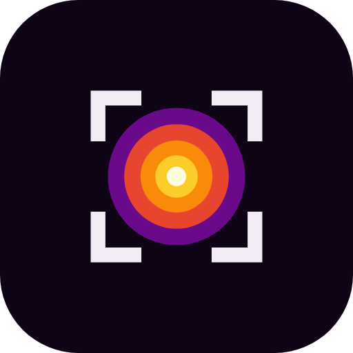
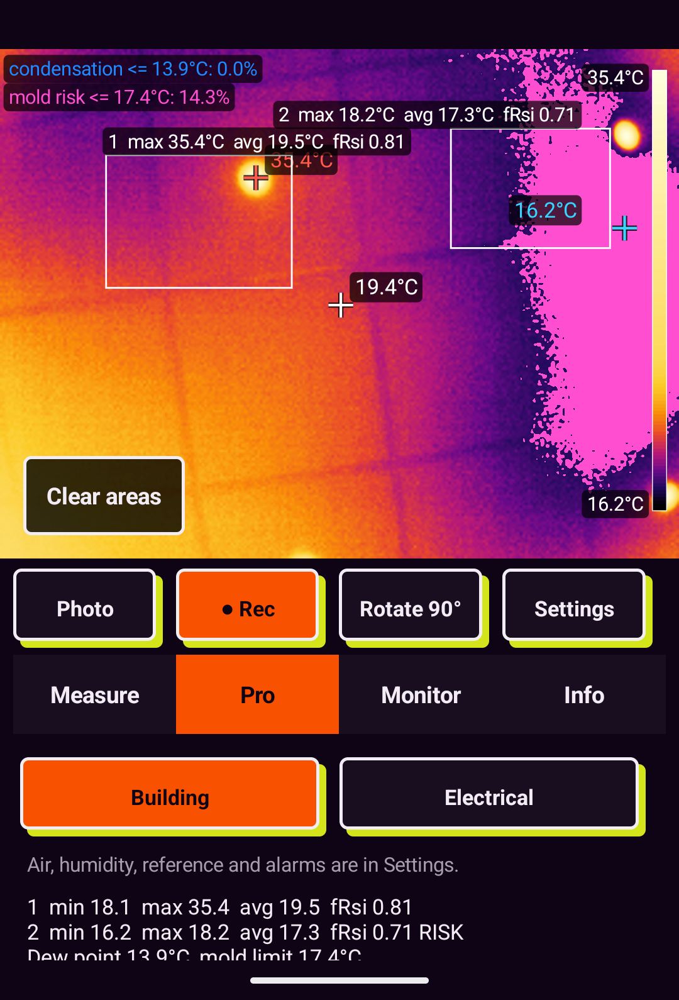
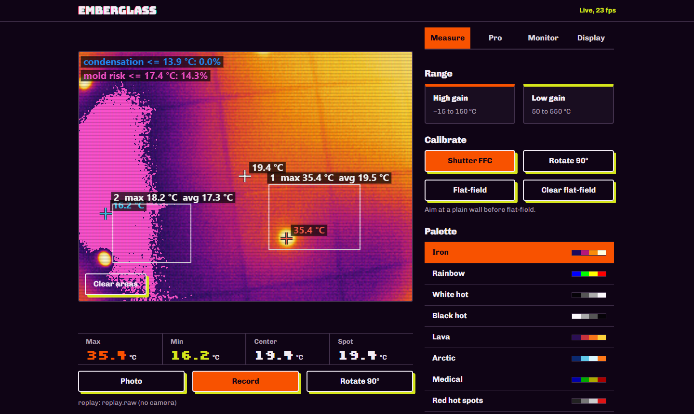
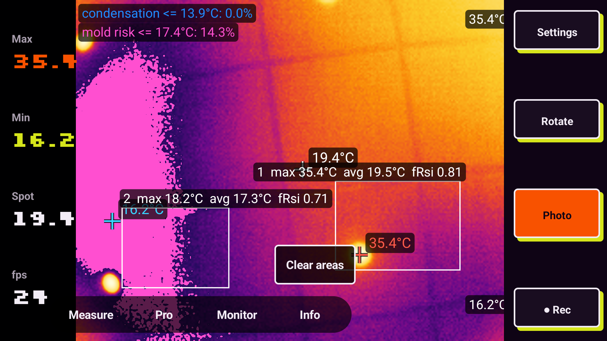

<p align="center"></p>

# Emberglass

[](https://github.com/MadeinTaly/emberglass/releases/latest) [](LICENSE) [](https://github.com/MadeinTaly/emberglass/releases)

*Memento ardere.*

An Android app for USB-C thermal cameras built on the InfiRay Tiny1-C module (256×192, 25 fps). It reads the camera's full radiometric data, draws it on the GPU, and streams it to any browser on your network, with tools for building diagnostics, electrical inspection and long-term monitoring.

The APK is about 230 KB. It is plain Java and OpenGL ES, plus a few hundred lines of C that read the camera directly through Linux usbfs. There is no vendor SDK, and Google services are not required.

<p align="center">
  
  
</p>
<p align="center"></p>

*Screenshots: frames recorded from a real camera, replayed on an Android emulator.*

## Supported cameras

| USB ID | Examples | Status |
|---|---|---|
| `0bda:5840` | Tiny1-C modules | Tested: video, temperatures and camera commands |
| `0bda:5830` | InfiRay P2 Pro, Topdon TC001 | Same module and protocol, untested |

Other Tiny1-C based cameras with a `256x384` YUYV stream will probably work too. Reports are welcome.

## Features

**Image**
- GPU rendering: the 16-bit temperature field goes to the GPU every frame. Bicubic upscaling, palettes, contrast curve and isotherms all run in a shader.
- Detail-enhanced contrast (plateau histogram equalization, as in professional cameras) or linear.
- Eight palettes: iron, rainbow, white hot, black hot, lava, arctic, medical, red hot spots.
- All four phone orientations. Each orientation remembers its own image rotation, set with Rotate 90°. Mirror for a camera that faces you.
- Portrait shows large readings under the image. Landscape works like a camera: full-screen image, readings at the side, controls in a column, tabs in a faded sheet.

**Measuring**
- Max, min, center and a tap-to-measure spot.
- Up to six measurement areas (boxes or points), each with min, max and average.
- Corrections sent to the camera: emissivity (with a materials table), reflected and ambient temperature, distance.
- Two ranges: −15…150 °C at high sensitivity, or 50…550 °C for hot objects.
- Shutter FFC, software flat-field and temporal denoise.
- The camera's own start-up calibration is detected and shown as warming up, never as wrong temperatures.

**Building diagnostics**
- Pixels at or below the dew point are shown in blue (condensation). Pixels where the surface humidity would exceed 80% are shown in pink (mold risk, EN ISO 13788). The share of the image at risk is shown on screen.
- Temperature factor fRsi for the coldest point and each area, compared with the minimum the air conditions require.
- A warning when inside and outside differ by less than 10 °C, too little for a reliable survey (EN 13187).

**Electrical inspection**
- ΔT of each area over a reference area or over ambient air.
- Severity in words, after NETA MTS Table 100.18: possible, probable, monitor, major.
- Rate alarm: warns when the maximum rises faster than a set number of degrees per minute.

**Capture**
- Photo: a JPEG in the gallery plus a radiometric TIFF in `Documents/Emberglass`. The TIFF holds 32-bit float °C for every pixel, with the settings and measurements as JSON in the file. It opens in ImageJ, MATLAB, Python, QGIS and GDAL.
- Video: H.265 when the phone has an encoder for it, otherwise H.264. Optionally saves the radiometric frames too.

**Monitoring for hours**
- A CSV sample every N seconds: max, min, center, spot, every area, the alarm state and events.
- Optional time-lapse photos and a trend graph on the phone and the web page.
- Keeps running with the screen off and the app closed. The app asks once to be exempted from battery optimisation. On vivo, Xiaomi, Huawei and similar phones, also allow high background power use in the app settings.

## Web interface

The phone shows its address, for example `http://192.168.1.20:8080`. The page receives the radiometric data over a WebSocket and draws it with WebGL, so hovering over the image shows the temperature of any pixel. The whole interface fits the window, with the viewer always visible.

| Path | What |
|---|---|
| `/` | Live page |
| `/ws` | Radiometric WebSocket: per frame, the status JSON, the palette, the contrast curve and the deflated temperatures |
| `/stream` | MJPEG stream for VLC, Home Assistant or OBS |
| `/snapshot.jpg` | Current frame |
| `/temps` | Status JSON |
| `/raw` | Current frame as 256×192 uint16 little-endian; °C = v / 64 − 273.15 |
| `/history`, `/log.csv` | Monitoring samples and log |
| `/cmd?name=…&v=…` | Commands: `palette`, `denoise`, `rotate`, `mirror`, `spot`, `region`, `flatfield`, `ffc`, `gain`, `emissivity`, `photo`, `record`, `monitor`, `set` |

There is no authentication by default. Set a PIN in the settings (`http://<phone>:8080/?pin=1234`), or turn off browser control, on networks you do not fully trust. The PIN travels in plain HTTP: it keeps casual visitors out, but does not protect against someone who can read your network traffic.

## Install

Download `emberglass.apk` from the [releases](../../releases), or let [Obtainium](https://obtainium.imranr.dev/) follow this repository. Then:

1. Open the app and allow the camera permission. Android requires it for any USB camera.
2. Plug in the thermal camera and allow USB access.
3. Wait a few seconds while the module calibrates.

## Build

You need the Android SDK (build-tools, platform 35, NDK) and a JDK 17 or newer. Gradle is not used.

```sh
./build.sh          # release build, signed with .signing.env or a local debug key
DEV=1 ./build.sh    # development build with the /debug channel (state, log, screenshots); never publish it
test/run.sh         # checks the building-physics math and the TIFF writer
```

With no camera attached, the app plays `Android/data/app.emberglass/files/replay.raw` (raw 256×384 YUYV frames) in a loop, for demos and emulators.

## Safety

- The app sends only documented, non-persistent setting commands to the camera.
- It never sends flash-write, firmware-update or reset commands.
- Changed settings are lost when the camera is unplugged.

Still, this is unofficial software: use it at your own risk. See the license for the absence of any warranty. Temperatures from an uncalibrated consumer camera are indicative; for decisions that matter, check against a contact thermometer.

InfiRay, P2 Pro and Topdon are trademarks of their respective owners. This project is not affiliated with them.

## Credits

- Interface theme: Arcade, from the Hallmark design system.
- Fonts: [Bungee](https://github.com/djrrb/Bungee), [Chivo](https://github.com/Omnibus-Type/Chivo) and [Silkscreen](https://github.com/googlefonts/silkscreen), under the SIL Open Font License 1.1 (`app/assets/fonts/OFL.txt`).
- Camera protocol notes: the community work collected in [HARDWARE.md](HARDWARE.md), in particular P2Pro-Viewer by LeoDJ, and p2-viewer by lbatalha and stanelie.

## License

[MIT](LICENSE). The fonts keep their own license (OFL 1.1).
